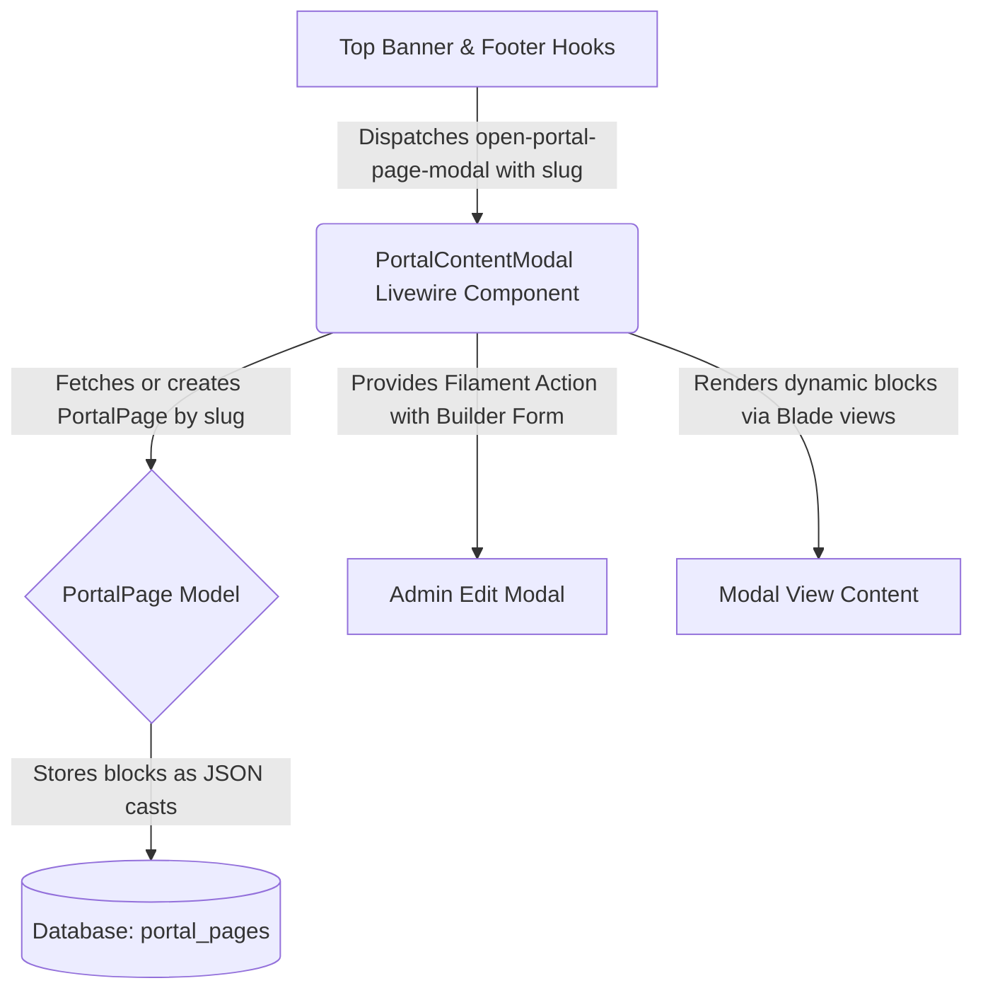

# Portal Pages Builder Refactoring Plan

## Architecture Overview

We are refactoring the dynamic modal content system (`PortalContentModal`, `top-banner.blade.php`, `bottom-footer.blade.php`, and `PortalPage` model/migration) to utilize **Filament Builder and Blocks** supporting Heading, Paragraph, Rich Text, and Accordion/FAQ blocks.

## Step-by-Step Implementation Plan

### 1. Database & Model Update
- **Migration**: Modify `portal_pages` table to support `blocks` (json) alongside `slug` and `title`.
- **Model**: Update [`PortalPage.php`](app/Models/PortalPage.php) to cast `blocks` as an array.

### 2. Filament Builder Definition in Livewire Component
- Update [`PortalContentModal.php`](app/Livewire/PortalContentModal.php) with Filament's `Builder` component containing:
  - **Heading Block**: text, level (h2, h3, h4)
  - **Paragraph Block**: text content
  - **Rich Text Block**: rich editor content
  - **Accordion / FAQ Block**: repeater for questions & answers
- Ensure authorization checks for updates (`can('update', PortalPage::class)`).

### 3. Updating Hooks and Event Triggers
- **Top Banner**: Fix help, faq, and contact buttons in [`top-banner.blade.php`](resources/views/filament/hooks/top-banner.blade.php) to dispatch `open-portal-page-modal` with correct slugs (`bantuan`, `faq`, `hubungi-kami`).
- **Bottom Footer**: Fix all footer links in [`bottom-footer.blade.php`](resources/views/filament/hooks/bottom-footer.blade.php) to dispatch `open-portal-page-modal` with respective slugs (`faq`, `dasar-keselamatan`, `dasar-privasi`, `penafian`, `hubungi-kami`).

### 4. Modal View & Rendering
- Update [`portal-content-modal.blade.php`](resources/views/livewire/portal-content-modal.blade.php) to render the Filament modal container, loop through and display the blocks, and show an admin edit button if authorized.
